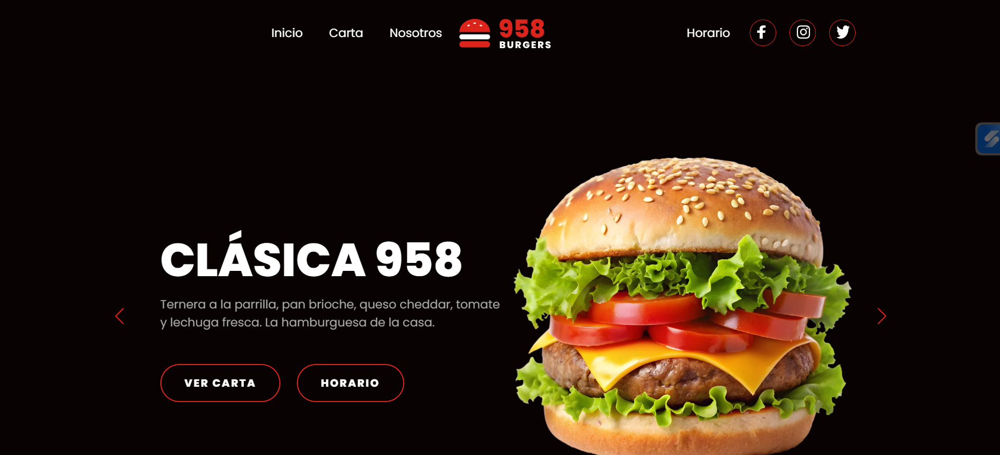
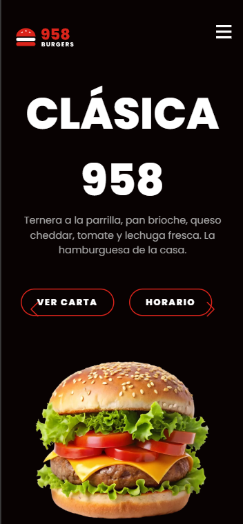

# 958 Burgers

Web de un restaurante ficticio de hamburguesas y burritos en Granada. Proyecto de práctica con HTML, CSS y JavaScript, sin frameworks.

> **Aviso:** 958 Burgers es un negocio inventado. La dirección, el teléfono, el email y el número de WhatsApp son ficticios.

**Demo:** https://proyecto-restaurante-edwin.netlify.app





## Funcionalidades

- **Carta filtrable** por categoría: Burgers, Burritos y Variedades.
- **Pedido por WhatsApp:** añade productos, ajusta cantidades, calcula el total y abre WhatsApp con el mensaje del pedido ya redactado.
- **Estado Abierto/Cerrado** en tiempo real según el horario, calculado con la hora de Madrid aunque el visitante esté en otra zona horaria.
- **Slider principal** con Swiper.
- **Diseño responsive** con menú hamburguesa en móvil.
- **Accesibilidad:** encabezados en orden, `alt` en las imágenes, foco visible con teclado y botones con etiquetas.

## Tecnologías

- HTML5 semántico
- CSS3 (Flexbox y Grid, sin librerías)
- JavaScript (vanilla)
- [Swiper 11](https://swiperjs.com/), alojado en `vendor/`

## Rendimiento

Medido con Lighthouse en móvil sobre la versión desplegada (mediana de 3 ejecuciones):

| Performance | Accessibility | Best Practices | SEO |
|:-----------:|:-------------:|:--------------:|:---:|
| 94 | 93 | 100 | 100 |

Optimizaciones aplicadas:

- Imágenes convertidas a WebP: de 71 MB a menos de 1,5 MB en total.
- `width` y `height` en las imágenes para evitar saltos de diseño.
- Fuentes de Google cargadas sin bloquear el primer pintado.
- Swiper alojado en el propio sitio, sin peticiones a un CDN externo.
- Slides secundarios del hero cargados al terminar la página.

## Estructura

```
proyecto_restaurante/
├── index.html
├── style.css
├── script.js
├── images/
├── vendor/        # Swiper (CSS y JS)
└── docs/          # capturas para este README
```

## Ejecutar en local

```bash
git clone https://github.com/https://github.com/edvillamizar/proyecto_restaurante.git
cd proyecto_restaurante
```

Abre `index.html` en el navegador o usa la extensión Live Server de VS Code.

## Configuración

Para probar el envío por WhatsApp, cambia el número en `script.js`:

```js
const WHATSAPP_NUMERO = "34600000000"; // prefijo de país, sin + ni espacios
```

## Autor

**Edwin Alejandro**, desarrollador web front end junior en Granada.  

Portfolio: https://portfolio-edwin-alejandro-villamizar.pages.dev/  

Linkedin: www.linkedin.com/in/edwinvillamizardiaz  
 

Diseño base inspirado en como "CREAR una PAGINA WEB DESDE CERO con HTML CSS y JAVASCRIP 🚀" Divcode